<div align="center">

# Hairso Studio

**사진 몇 장과 한 줄 설명으로 세로 쇼츠(9:16) 초안을 만들고, 로컬 AI 로 렌더까지 돌리는 소상공인 홍보 영상 스튜디오**


</div>

> **제품 정체성.** 초기 기획은 "고객 얼굴을 유지한 헤어스타일 상담(HairView AI)" 이었고([`docs/PRD.md`](./docs/PRD.md)), 현재 제품은 **헤어·뷰티·로컬 비즈니스 홍보 쇼츠 제작 스튜디오(Hairso Studio)** 로 범위를 전환했다([`docs/PRD-video-studio.md`](./docs/PRD-video-studio.md) · [`docs/STUDIO_MVP_PLAN.md`](./docs/STUDIO_MVP_PLAN.md)). 상담 흐름(촬영·스타일 분석·QR 공유)은 로드맵이다.
>
> **기본 Provider 는 전부 Mock** 이다. API 키·GPU·모델 없이 초안 → 렌더(202) → 폴링 → 완료까지 실제로 돈다. 실제 AI 생성은 로컬 GPU 서버(`ml/`)를 **opt-in** 으로 붙인다.

---

## 화면 미리보기

> 모든 캡처는 **Mock Provider·인메모리** 환경(2026-10-17)에서 찍었다. 업로드 이미지는 랜딩 화면을 잘라 만든 더미 PNG 이며 고객 사진은 사용하지 않았다.

**Studio — 초안(Script & Storyboard) 편집과 9:16 프리뷰.** 앞 단계(템플릿 → 브리프 → 이미지 업로드)는 아래 갤러리.

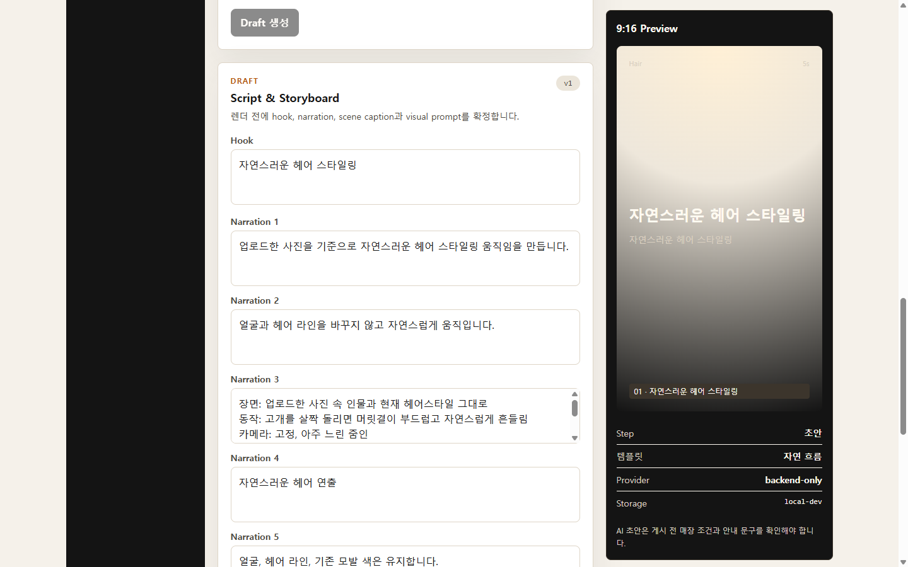

| 랜딩 | 템플릿 14종 · 카테고리 7종 |
|---|---|
| 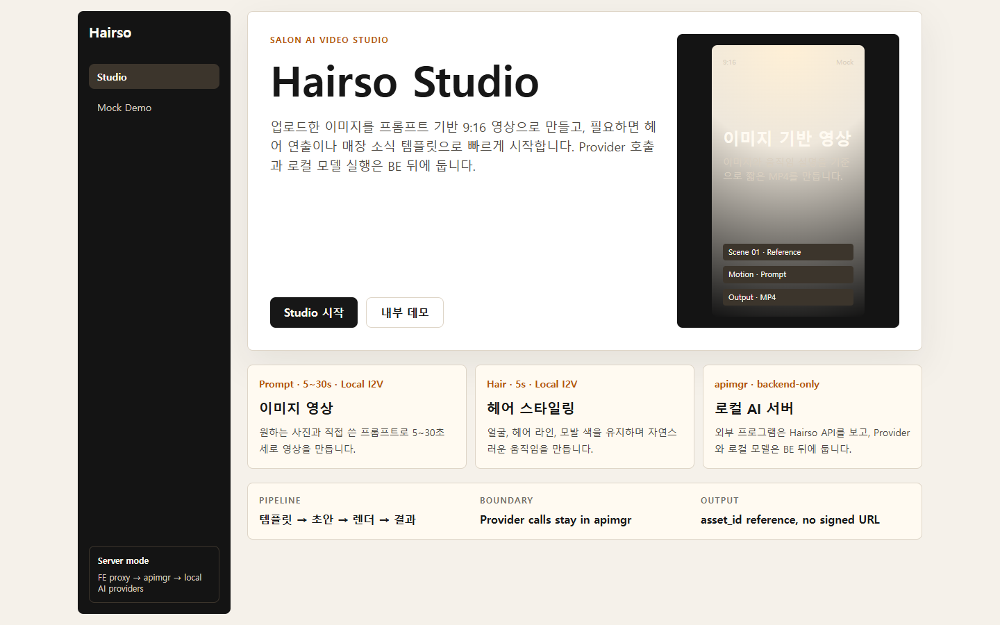 | 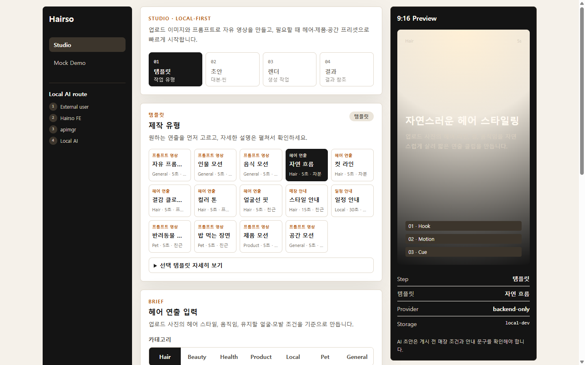 |

| 브리프 입력 · 이미지 업로드(더미 PNG → asset_id 자동 입력) | 렌더 완료 · Download 활성 (Preview·QR 은 자리표시) |
|---|---|
| 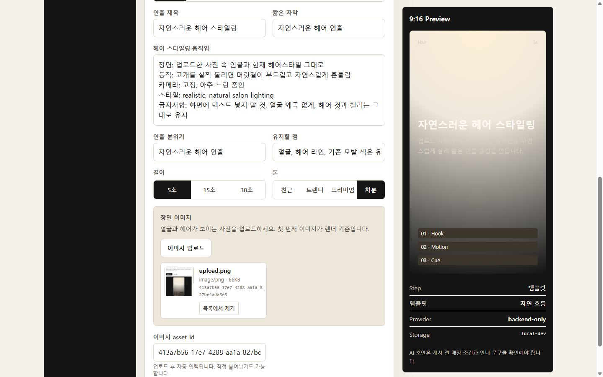 | 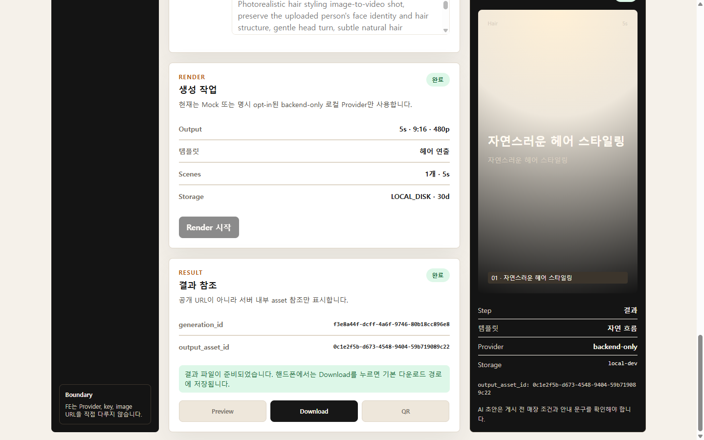 |

| 자유 프롬프트 모드 | 매장 안내 템플릿(요청 15초 · Scene 3개) 초안 |
|---|---|
| 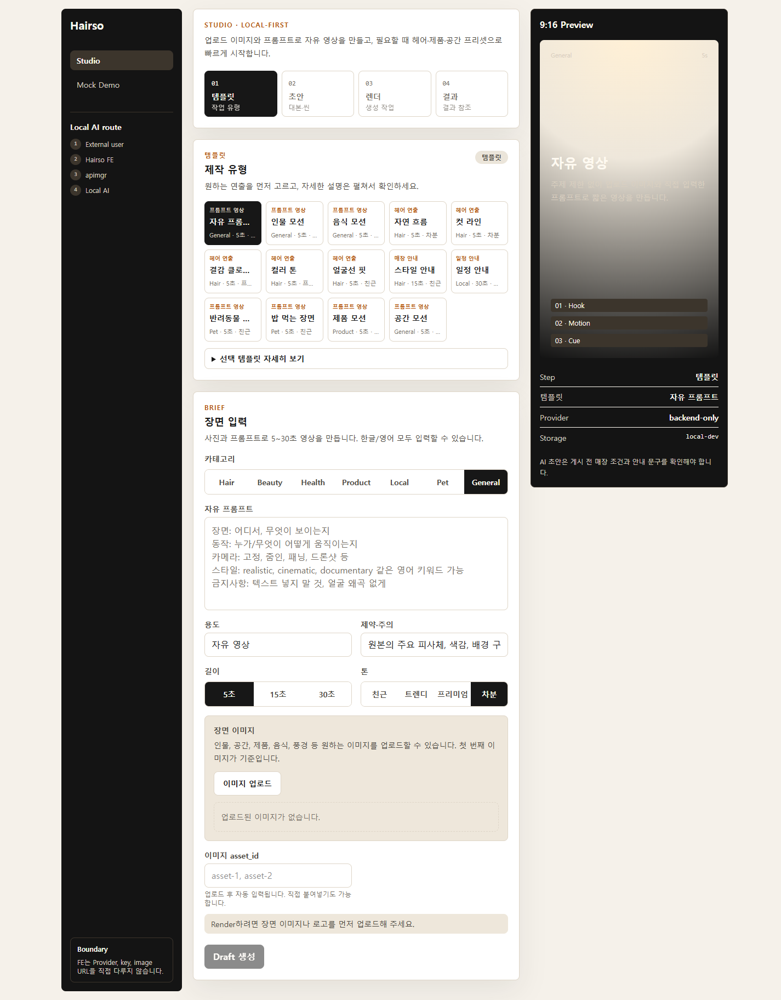 | 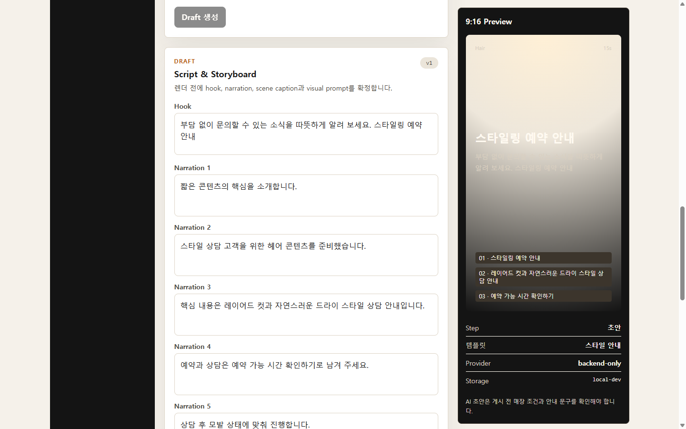 |

<details>
<summary><b>모바일(390px)</b> — 사이드바 숨김, 프리뷰 패널 하단 적층</summary>

| 랜딩 | 초안 편집 | 렌더 완료 |
|---|---|---|
| 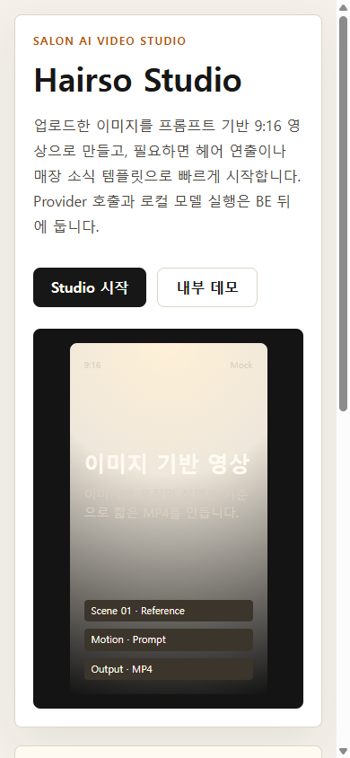 | 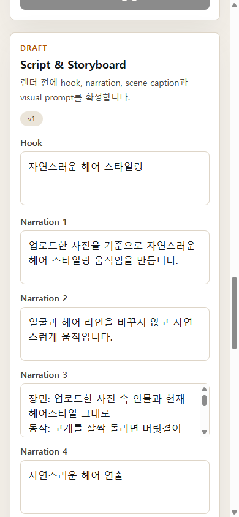 | 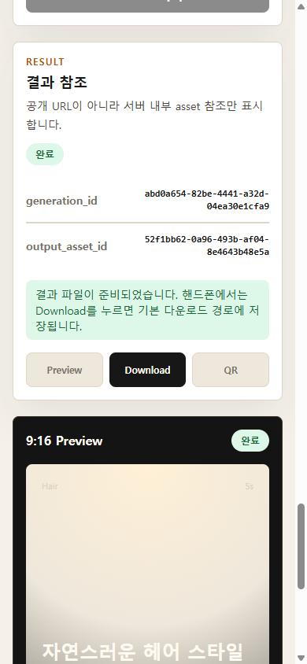 |

</details>

---

## 1. 기획

### 1.1 문제와 타깃

- 미용실·뷰티샵·동네 가게는 홍보 쇼츠가 필요하지만 촬영·편집·문구 작성을 직접 하기 어렵다.
- Hairso Studio 는 **매장 사진 ≤6장 + 짧은 설명** 만으로 대본·스토리보드 초안을 만들고, 편집 후 9:16 영상을 렌더한다.
- 타깃: 미용실 원장 · 헤어 디자이너 · 뷰티샵 마케터 → 이후 헤어·뷰티·헬스·제품 정보 쇼츠 크리에이터.
- 범용 영상 편집기가 아니라 **"하나의 안정적인 홍보 쇼츠 흐름"** 을 먼저 완성한다. 유료 Provider·타임라인 편집·SNS 자동 게시는 범위 밖(PRD §Out of Scope).

### 1.2 핵심 흐름

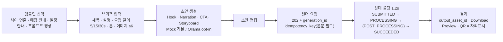

### 1.3 템플릿과 카테고리 (코드 기준)

| 축 | 값 | 출처 |
|---|---|---|
| 템플릿 타입 4 | `HAIR_STYLING_MOTION` · `PROMOTION_SHORT` · `SALON_EVENT_PROMOTION` · `FREE_IMAGE_TO_VIDEO` | `apimgr/app/domain/enums.py` |
| 카테고리 7 | Hair · Beauty · Health · Product · Local · Pet · General | `apimgr/app/domain/enums.py` |
| FE 프리셋 14 | 헤어 연출 5(자연 흐름·컷 라인·결감 클로즈업·컬러 톤·얼굴선 핏) · 매장 안내 1 · 일정 안내 1 · 프롬프트 영상 7(자유·인물·음식·반려동물 2·제품·공간) | `hairsoui/src/features/studio/StudioWorkspace.tsx` |
| 요청 길이 · 톤 | 5 / 15 / 30초(요청 길이 — 내장 Wan 경로는 `WAN_VIDEO_MAX_SECONDS` 기본 5초로 클램프, 외부 렌더 명령 경로는 그대로 전달. Mock 은 더미 MP4) · 친근 / 트렌디 / 프리미엄 / 차분 | 〃 · `ml/wan_video.py` |

첫 happy path 템플릿은 **Hair Styling(헤어 연출)** — 업로드 사진의 얼굴·헤어 라인·모발 색을 유지하도록 프롬프트로 **지시**하고 자연스러운 움직임만 만든다(보존 결과는 모델에 달려 있어 확정적이지 않다). 얼굴 자체를 바꾸는 요청은 범위 밖이다.

### 1.4 화면 구성

| 라우트 | 역할 | 단계 / 상태 |
|---|---|---|
| `/` | 랜딩. Studio 진입, 파이프라인 요약, 로컬 AI 서버 안내 | 정적 |
| `/studio` | 작업 화면(단일 페이지 4단계) | **템플릿 → 초안 → 렌더 → 결과**, phase `idle · drafting · editing · rendering · done · error` |
| `/try` | 저수준 생성 흐름 내부 회귀 데모(피벗 전 흐름 유지) — **제품 진입점 아님**, 캡처 없음 | 프롬프트 → 202 → 폴링 → 자리표시 |

### 1.5 이번 MVP 범위 밖

타임라인 편집기 · SNS 자동 게시 · 멀티 아바타 · 실시간 립싱크 · 가로/정사각 출력 · FE 에서 Provider 직접 호출 · 로컬 테스트 중 유료 Provider 자동 호출 · 고객 이미지 브라우저 저장. 상세: [`docs/PRD-video-studio.md`](./docs/PRD-video-studio.md).

---

## 2. 아키텍처

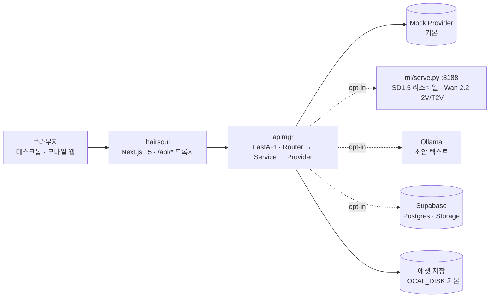

- **경계 원칙.** FE 는 Provider·API 키·이미지 URL 을 다루지 않는다. 외부/로컬 AI 호출은 전부 BE 를 거친다(`FE → apimgr → Provider → apimgr → FE`).
- **비동기 생성.** 렌더 요청은 즉시 `202 + generation_id` 를 돌려주고, 데모용 BackgroundTasks 폴러가 Provider 상태를 폴링해 `SUBMITTED → PROCESSING → POST_PROCESSING → SUCCEEDED` 로 전이시킨다(상태 10종, 전이 규칙 한 곳 관리). 같은 `idempotency_key`(요청 본문 필드) 재요청은 기존 작업을 돌려준다.
- **재시작 복원(lazy advance, 영속 저장 전제).** `DATABASE_URL` 로 작업 메타데이터가 Supabase 에 영속되고, ml 서버의 job 이 살아 있으며, BE 가 재시작 전과 같은 `DEFAULT_VIDEO_PROVIDER` 설정으로 다시 뜬 경우에 한해(조회는 저장된 작업의 Provider 가 아니라 **현재 기본 Provider** 로 수행), 폴러가 사라져도 `GET /generations/{id}` 조회가 ml job 상태를 1회 전진시켜 완료를 반영한다. `GET /studio/projects/{id}` 경로는 0003 적용이 선행돼야 한다. **기본 인메모리 저장소에서는 BE 재시작 시 작업 정보가 사라져 복원되지 않으며**, Mock Provider 는 lazy advance 대상이 아니다. FE 는 BE 가 살아 있는 동안 `localStorage` 의 project id 로 **서버에 저장된 프로젝트·초안·렌더 상태만** 복원한다 — 렌더 전에 화면에서 고친 초안(서버 저장은 렌더 시작 시 1회), 업로드 썸네일, 선택했던 프리셋(같은 템플릿 타입의 첫 프리셋으로 표시)은 복원되지 않는다.
- **저장소.** 모노레포 1개(`hairsoui/` FE · `apimgr/` BE · `ml/` 로컬 추론 · `docs/`). 상세: [`docs/ARCHITECTURE.md`](./docs/ARCHITECTURE.md).

<details>
<summary><b>API 목록</b> — BE Swagger (<code>/docs</code>, 라우트 15 + root)</summary>

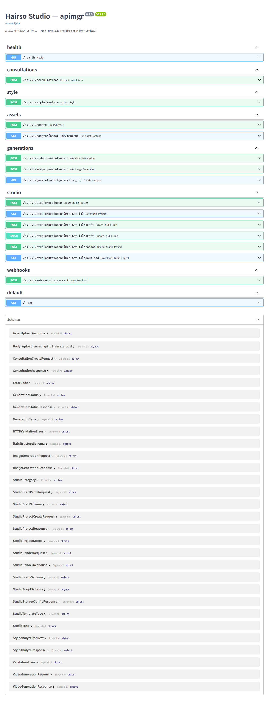

</details>

---

## 3. 현재 진행사항

> 정본은 [`docs/LABELS.md`](./docs/LABELS.md)(상태 라벨)와 [`docs/TASKS.md`](./docs/TASKS.md)(남은 작업). 아래 수치는 **2026-10-17 로컬 실행 결과** 만 적는다. 진행률 % 는 근거가 없어 쓰지 않는다.

### 3.1 영역별 상태

| 영역 | 구현 · 기본 동작(Mock) | opt-in 실구현(로컬 · 자격증명 필요) | 로드맵(미구현) |
|---|---|---|---|
| **FE** `hairsoui` | 라우트 3 · Studio 4단계 흐름 · 프리셋 14 / 타입 4 / 카테고리 7 · 길이 5/15/30초(요청값) · 이미지 업로드(MIME·10MB·512px 검증, 최대 6장, Object URL 미리보기) · 초안 편집(Hook·Narration·CTA·Scene) · 렌더 `idempotency_key` · 1.2초 폴링 · Download 링크 · 새로고침 복원 · API 클라이언트(Zod 파싱, 오류코드 18 → 사용자 메시지) · 상태 Mapper 10키 · 공통 컴포넌트 3 · 계약 parity 테스트 10건(enum 10종 ↔ `contract/enums.json` 12키 중 FE 사용분) | — | Preview·QR(자리표시) · 카메라/MediaPipe(코드 없음) · 로그인 연동(토큰 공급자 훅만, 호출처 없음 → 전 요청 익명) · 로고 업로드 UI · 이미지 리스타일 화면 · API 기본 타임아웃 |
| **BE** `apimgr` | API 라우트 15(+root) — health · consultations(스텁) · style/analyze(Mock 고정) · assets 업로드/다운로드 · video/image-generations · generations 상태 · studio 6(projects/draft/render/download) · webhooks/pixverse(스텁) · 상태머신 10종 · idempotency · 오류 envelope · Mock 영상 Provider 8 시나리오 | `SELF_HOSTED_WAN`(ml job 등록→폴링→MP4 저장) · `LOCAL_SD`(ml `/restyle`) · `OLLAMA`(초안, 실패 시 Mock fallback) · Supabase Storage(비공개 버킷) · Supabase Postgres Repository(`DATABASE_URL`) · Supabase JWT **선택적** 인증 · lazy advance(`DATABASE_URL` 영속 전제) | PixVerse(스텁 `NotImplementedError`) · fal · Wan Cloud · Gemini · Worker 큐(현재 데모용 BackgroundTasks) · Webhook 실 payload 파싱 · 상담 영속 · 크레딧 · 공유/QR · 인증 필수화 |
| **ml** `ml/serve.py` | — | `POST /restyle`(SD1.5 inpaint + face-parsing 헤어 마스크) · `POST /video/i2v` → `GET /video/i2v/{job}` → `GET …/output`(Wan 2.2 TI2V-5B Diffusers, I2V/T2V, 내장 경로는 요청 초를 `WAN_VIDEO_MAX_SECONDS`(기본 5)로 자른 뒤 프레임 올림으로 인코딩(기본 약 5.04초; 외부 명령 경로는 미적용), idempotency_key 순차 중복 방지, GPU 직렬 락·모델 CPU 스왑) · GGUF transformer 옵션 · 외부 렌더 명령 대체 경로 | job 영속화(현재 메모리·TTL 없음) · 1:1 비율 / 1080p 매핑 |
| **DB** Supabase | 인메모리(기본) | `0001_video_mvp`(assets·generations·consents, RLS 전체 차단) **적용됨**(문서 기준) · `0002_local_sd_provider` **미확인** · `0003_studio_mvp`(5테이블) **설계만** | 나머지 7테이블(salons…credit_transactions) · Alembic 미도입(SQL 수동 적용) |

### 3.2 검증 결과 (2026-10-17 실행)

| 대상 | 명령 | 결과 |
|---|---|---|
| BE | `pytest -q` | **107 passed · 5 skipped**(Supabase 라운드트립은 `DATABASE_URL` 미설정 시 skip) |
| BE | `python -m compileall app main.py tests scripts` | OK |
| FE | `npm run typecheck` / `npm run lint` | 오류 0 / 경고 0 |
| FE | `npm run test` | **20 passed** |
| FE | `npm run build` | 통과(`/` · `/studio` · `/try` 정적) |
| FE | 오류 표시 수정(수동) | BE 중지 상태에서 초안 생성(데스크톱)·렌더 시작(데스크톱·모바일) 3경로의 메시지 표시 확인. 실제 실패 지점은 선행 호출(`POST /studio/projects` · `PATCH …/draft`)이며 `POST …/draft`·`POST …/render` 자체의 오류 응답 경로와 폴링 실패·복원 실패는 미검증(네 호출이 같은 오류 처리 분기를 공유). 컴포넌트 자동 테스트 없음 |
| BE | `ruff check app main.py tests scripts` | 통과(ruff 0.15.21) |

### 3.3 다음 작업과 알려진 제약

**다음 작업** (상세 [`docs/STUDIO_MVP_PLAN.md`](./docs/STUDIO_MVP_PLAN.md) §9 · [`docs/TASKS.md`](./docs/TASKS.md))

1. Studio 결과 자리표시를 실제 MP4 Preview 로 교체
2. 기존 asset 을 고르는 라이브러리 선택 UI(현재는 파일 업로드 또는 asset_id 직접 입력)
3. QR/공유 토큰(만료·권한 정책 확정 뒤)
4. DB 영속·Worker 큐(마이그레이션 승인 뒤) — 0003 Studio 테이블 적용 포함
5. Wan 2.2 를 운영 Provider 로 승격(GPU·비용·라이선스 검토 뒤)

**알려진 제약**

*보안·인증*
- 인증이 **선택적** 이라 Bearer 토큰 없는 요청은 익명으로 통과한다. 인증된 사용자의 프로젝트는 소유자만 접근하지만, **익명으로 만든 프로젝트는 `project_id` 만 알면 누구나(인증 사용자 포함) 조회·초안 생성·초안 수정·렌더·다운로드가 가능하다**(Studio 접근 검사가 전 작업 공통). 포트를 인터넷에 직접 노출하지 말 것.
- `GET /generations/{id}` 는 소유권을 확인하지 않는다(generation_id 만 알면 상태 조회·lazy advance 트리거 가능).

*렌더 범위*
- 로컬 AI Provider(`LOCAL_SD`·`SELF_HOSTED_WAN`)는 `LOCAL_*_INFERENCE_URL` 호스트를 `127.0.0.1`·`localhost`·`::1`·`host.docker.internal`·`ml` 로 제한한다(`self_hosted_wan.py`, `image_generation/local.py`). 제한은 **BE→ml 구간** 이므로 BE 와 ml 은 같은 호스트에 있어야 한다(compose 에서 `ml` 서비스명으로 붙이는 경우도 허용 목록에 있으나 현 dev compose 에는 `ml` 서비스가 없다). FE 만 다른 PC 에 두는 것은 `API_PROXY_TARGET`(`next.config.mjs`)으로 가능하며, 권장 구성은 FE·BE·ml 을 GPU PC 에서 모두 띄우는 방식(아래 원격 모드)이다.
- 영상 길이 5/15/30초는 **요청·초안 길이**다. 내장 Diffusers 경로(`ml/wan_video.py`)는 `WAN_VIDEO_MAX_SECONDS`(기본 5, 변경 가능)로 요청 길이를 자르고 프레임 수를 4k+1 로 올림하므로 기본 설정의 실제 파일은 약 5.04초(121프레임/24fps)다. 외부 렌더 명령 경로(`LOCAL_VIDEO_RENDER_COMMAND`)는 요청 길이를 그대로 전달한다. Studio 의 "Output 15s"·"Scenes 3개 · 15s" 표시는 요청값이다.
- 렌더는 **이미지 1장**(로고가 있으면 로고, 없으면 첫 이미지)과 프롬프트 1개로 단일 클립을 만든다. 편집한 초안이 프롬프트에 반영되는 범위는 템플릿별로 다르다 — 헤어 연출·프롬프트 영상: 제목·설명·scene `visual_prompt` / 매장·일정 안내: Hook·Narration·CTA·scene caption. 장면별 합성·장면 길이는 반영하지 않는다.
- 렌더는 프로젝트당 1회다. 렌더 작업 ID 가 프로젝트에 연결된 뒤에는 FE 가 초안 편집·재렌더를 잠그고, BE 는 새 `idempotency_key` 로 요청해도 상태(성공·실패)와 무관하게 기존 작업을 돌려준다. 작업 ID 연결 **전** 실패(초안 저장·렌더 등록 요청 실패)는 같은 화면에서 재시도할 수 있고 FE 는 같은 `idempotency_key` 를 재사용한다. 다시 만들려면 "새 작업" 으로 새 프로젝트를 만들되, 기존 `asset_id` 를 다시 입력하면 재업로드 없이 가능하다. BE 초안 수정 API 는 렌더 후에도 열려 있으나 결과에는 반영되지 않는다(PRD 의 Regenerate / Edit-and-rerender 는 로드맵).
- 얼굴 보존 지시("Preserve face identity")와 공통 제약("실존 인물 묘사·모방 금지")이 같은 프롬프트에 공존한다 — 보존 동작은 확정적이지 않다.
- `aspect_ratio` 1:1 과 `quality` 1080p 는 ml 에서 9:16 · 480p 로 강등된다(Studio 경로는 9:16 고정이라 영향 없음).

*운영·내부 구조*
- 기본 인메모리 저장소에서는 BE 재시작 시 프로젝트·작업 정보가 사라진다(영속은 `DATABASE_URL` + 마이그레이션 적용 전제).
- 렌더 진행 안내 문구("이 PC 의 AI 서버에서… 8~10분")가 Provider 와 무관하게 로컬 Wan 기준으로 표시된다(Mock 에서는 수 초 내 완료).
- ml 서버 job 목록이 메모리에만 있어 ml 재시작 시 진행 중 작업은 FAILED 처리되고, 완료 MP4 가 메모리에 남는다(TTL 없음). ml 서버 HTTP 오류는 재시도 없이 즉시 FAILED 로 전이한다(일시 장애도 실패 처리).
- 동시 요청 멱등성은 근사다 — 같은 `idempotency_key` 의 순차 재요청은 막지만, 동시 요청이나 같은 프로젝트에 서로 다른 키가 동시에 들어오면 중복 제출될 수 있다(DB UNIQUE·잠금 도입 전). lazy advance 와 백그라운드 폴러의 상호 배제도 완전하지 않다.
- `/video-generations`·`/studio` 라우터 안에 폴링·전진 로직이 중복 정의돼 있다(Worker 계층으로 이동 예정). `POST /image-generations` 는 FE 에 연결돼 있지 않다(로컬 검증 스크립트로만 확인).
- `ASSET_LOCAL_ROOT` 를 비우면 에셋이 **clone 상위 폴더의 `models/`** 에 저장된다(고객 이미지를 저장소 밖에 두기 위한 기본값). 명시 설정을 권장한다. 보존기간(`STUDIO_OUTPUT_RETENTION_DAYS`, 화면의 "LOCAL_DISK · 30d")은 `expires_at` 메타데이터 기록일 뿐 **자동 삭제 Worker 는 미구현**이다.
- 랜딩·Studio 사이드바의 "Mock Demo / 내부 데모" 링크는 `/try` 로 연결되는데, 기획상 제품 진입점이 아니다(존치 여부 결정 필요).

---

## 4. 실행 방법

### 요구사항

| 도구 | 버전 | 확인 |
|---|---|---|
| Git | — | `git --version` |
| Python | 3.12+ (`pyproject.toml` `requires-python`) | `python --version` |
| Node.js | Next.js 15.5 가 요구하는 버전(`engines` 미지정) | `node -v` |

Docker Desktop 이 있으면 Python·Node 없이도 된다(아래 Docker 절).

### Quickstart (Windows PowerShell 기준)

```powershell
git clone https://github.com/goo-hyunju/hairso.git
cd hairso

# 1) BE (apimgr) — 포트 8000
cd apimgr
python -m venv .venv
.venv\Scripts\python -m pip install -e ".[dev]"
.venv\Scripts\python main.py          # http://localhost:8000/docs
cd ..

# 2) FE (hairsoui) — 포트 3000 (다른 터미널)
cd hairsoui
npm install
npm run dev                            # http://localhost:3000/studio
```

macOS/Linux 는 `.venv\Scripts\` 대신 `.venv/bin/` 을 쓴다. 브라우저 → FE(:3000) → `/api/*` 프록시(`next.config.mjs`) → BE(:8000) 구조라 CORS 설정이 필요 없다. 배선 상세: [`docs/LOCAL_DEV.md`](./docs/LOCAL_DEV.md).

### AI·GPU 가 없어도 전체 흐름이 돈다

기본 Provider 는 전부 **Mock** — API 키·GPU·모델 없이 초안 생성 → 렌더 202 → 폴링 → SUCCEEDED 왕복이 실제로 동작한다(결과물은 더미 MP4). 실제 AI 생성은 opt-in:

| 기능 | 필요한 것 | 설정 (`apimgr/.env`) |
|---|---|---|
| Studio 초안 텍스트 | 로컬 [Ollama](https://ollama.com) + 모델 | `DEFAULT_STUDIO_DRAFT_PROVIDER=OLLAMA` + `OLLAMA_STUDIO_DRAFT_MODEL=<모델명>`(모델명이 비면 Mock 으로 fallback) |
| 이미지 헤어 리스타일 | GPU(CUDA) + `ml/serve.py`(SD1.5 inpaint 5.2GB + face-parsing 0.3GB) | `DEFAULT_IMAGE_PROVIDER=LOCAL_SD` |
| 로컬 MP4 렌더 | GPU(CUDA) + `ml/serve.py`(Wan 2.2, 모델 32GB) | `DEFAULT_VIDEO_PROVIDER=SELF_HOSTED_WAN` |
| 영속 저장 | Supabase 프로젝트(0001 적용 · **Studio 경로는 0003 적용 필요**) | `DATABASE_URL`(`.env.example` 주석의 형식 참고) · 스토리지는 `ASSET_STORE_BACKEND=SUPABASE` + `SUPABASE_URL` + `SUPABASE_SECRET_KEY` |

Provider·저장소 환경변수 목록은 `apimgr/.env.example`(그대로 복사하면 Mock·인메모리로 동작한다). 서버 바인딩 `APP_HOST`·`APP_PORT`·`APP_RELOAD`·`APP_LOAD_DOTENV` 는 **프로세스 환경변수로만** 적용된다(`main.py` 가 `.env` 로더보다 먼저 읽는다). `ASSET_LOCAL_ROOT` 는 명시 설정을 권장한다(비우면 clone 상위 폴더 `models/`).

<details>
<summary><b>로컬 AI(GPU) 환경 처음부터 — <code>ml/serve.py</code></b> · RTX 5060 Ti 8GB 실측 포함</summary>

이미지 헤어 리스타일(SD1.5 inpaint)과 영상 생성(Wan 2.2 TI2V-5B, 텍스트/이미지→영상)을 한 프로세스(:8188)가 담당한다.

**요구사항**

| 항목 | 최소 | 비고 |
|---|---|---|
| GPU | NVIDIA 8GB VRAM | 최신 드라이버 (`nvidia-smi` 동작 확인) |
| 시스템 RAM | 권장 64GB(작성자 실측 환경) | 32GB 는 미검증 — 모델 CPU 오프로딩에 쓰므로 더 적으면 로드 실패 가능 |
| 디스크 여유 | 45GB+ | Wan 2.2 32GB + SD1.5 5.2GB + face-parsing 0.3GB (HF 캐시 실측 2026-10-17, `%USERPROFILE%\.cache\huggingface`) |

**셋업 (최초 1회)**

```powershell
cd ml
python -m venv .venv
.venv\Scripts\python -m pip install torch torchvision --index-url https://download.pytorch.org/whl/cu128
.venv\Scripts\python -m pip install fastapi uvicorn python-multipart pillow numpy
.venv\Scripts\python -m pip install -r requirements-wan.txt

# CUDA 인식 확인 — True 와 GPU 이름이 나와야 한다
.venv\Scripts\python -c "import torch; print(torch.cuda.is_available(), torch.cuda.get_device_name(0))"
```

**실행**

> ⚠️ 반드시 `ml\.venv` 의 Python 으로 실행한다. 시스템 `python` 으로 띄우면 의존성이 달라 모델 로드는 되는데 생성만 실패하는 식으로 깨진다.

```powershell
cd ml
$env:WAN_VIDEO_MODEL_ID='Wan-AI/Wan2.2-TI2V-5B-Diffusers'
$env:WAN_VIDEO_MAX_SECONDS='5'
$env:WAN_VIDEO_FPS='24'
.venv\Scripts\python -m uvicorn serve:app --host 127.0.0.1 --port 8188
```

- 확인: <http://127.0.0.1:8188/health> → `{"status":"ok","device":"cuda"}`
- 모델은 **최초 요청 시** Hugging Face 에서 자동 다운로드된다(영상 모델 32GB — 첫 생성은 다운로드 시간만큼 오래 걸림).

BE 연결 — `apimgr/.env`:

```text
DEFAULT_IMAGE_PROVIDER=LOCAL_SD
DEFAULT_VIDEO_PROVIDER=SELF_HOSTED_WAN
LOCAL_INFERENCE_URL=http://127.0.0.1:8188
LOCAL_VIDEO_INFERENCE_URL=http://127.0.0.1:8188
LOCAL_VIDEO_TIMEOUT_SECONDS=3600
```

**전체 실행 순서 (터미널 3개)** — ① ml(:8188) → ② BE `cd apimgr; .venv\Scripts\python main.py` → ③ FE `cd hairsoui; npm run dev` → <http://localhost:3000/studio>. 종료는 역순(FE → BE → ml).

**실측 성능 (RTX 5060 Ti 8GB, 2026-08 — 작성자 수동 측정, 재현 스크립트 없음)**

| 작업 | 소요 시간 | VRAM 피크 |
|---|---|---|
| 이미지 리스타일 (512px) | 15~21초 | ~3.4GB |
| 영상 480p·5초 (Studio 기본) | 약 9분 | ~5.2GB |
| 영상 720p·5초 | 약 30분 | ~7.7GB |

이미지·영상 모델은 GPU 메모리를 자동으로 나눠 쓴다(영상 생성 전 이미지 모델을 CPU 로 스왑, 직렬 실행). 영상이 오래 `PROCESSING` 인 것은 정상이며, 브라우저를 새로고침해도 완료는 반영된다.

**트러블슈팅**

| 증상 | 원인·조치 |
|---|---|
| "일시적인 오류가 발생했어요" | ① BE 재시작 중(코드 저장 시 자동 재시작) — 잠시 후 재시도. ② VPN 이 DNS 를 깨서 Supabase 연결 실패 — `nslookup google.com` 이 타임아웃이면 VPN 을 끄거나 DNS 를 8.8.8.8 로. 급하면 `DATABASE_URL` 을 주석 처리(인메모리로 동작, 재시작 시 이력 소실). |
| 영상 생성 FAILED (`WAN_VIDEO_*` 코드) | ml 서버 콘솔의 traceback 확인. OOM 이면 다른 GPU 사용 프로그램을 종료 — 영상 생성은 8GB 를 거의 전부 쓴다. |
| ml 서버가 안 뜸 | `ml\.venv` Python 으로 실행했는지, `pip install` 단계가 다 끝났는지 확인. |

</details>

<details>
<summary><b>원격 AI 서버 모드</b> — GPU PC 를 켜두고 다른 PC 에서 쓰기</summary>

두 PC 가 **같은 네트워크(공유기/사내망)** 에 있다는 전제다.

**권장 구성 — 서버 PC 에서 FE·BE·ml 을 모두 실행하고, 클라이언트는 브라우저만 쓴다**

> BE 의 로컬 AI Provider 는 `127.0.0.1`·`localhost`·`::1`·`host.docker.internal`·`ml` 호스트만 허용하므로 **BE 와 ml 은 같은 PC** 에 있어야 한다(LAN·Tailscale IP 로 `LOCAL_*_INFERENCE_URL` 을 지정하면 거부됨). FE 를 다른 PC 에 두고 `API_PROXY_TARGET=http://<서버IP>:8000` 으로 BE 를 가리키는 구성은 가능하지만(BE 는 프로세스 환경변수 `APP_HOST=0.0.0.0` 필요), 인증 없는 BE 포트를 여는 절차라 이 문서에서는 다루지 않는다.

```
[클라이언트 PC]                [서버 PC]
브라우저만        ──HTTP──▶  FE(0.0.0.0:3000) ─▶ BE(:8000) ─▶ ml/serve.py(:8188)
```

서버 PC:

```powershell
cd apimgr; .venv\Scripts\python main.py                     # BE (내부 통신이라 외부 바인딩 불필요)
cd hairsoui; npm run dev -- --hostname 0.0.0.0              # FE (다른 터미널)
cd ml; .venv\Scripts\python -m uvicorn serve:app --host 127.0.0.1 --port 8188   # (opt-in)
ipconfig                                                     # LAN IP 확인 (예: 192.168.0.10)
```

방화벽은 **3000 하나만** 연다(관리자 PowerShell, 최초 1회):

```powershell
netsh advfirewall firewall add rule name="hairso FE" dir=in action=allow protocol=TCP localport=3000
```

클라이언트 PC 브라우저에서 `http://<서버IP>:3000/studio`.

**인터넷 너머에서 접속 — Tailscale 권장**

이 서비스는 고객 이미지를 다루고 인증이 선택적(익명 허용)이므로, **공유기 포트포워딩으로 3000/8188 을 인터넷에 직접 여는 것은 금지**다. 외부 접속은 [Tailscale](https://tailscale.com) 로 두 PC 를 가상 LAN 으로 묶는다(포트포워딩·공인 IP 불필요, 본인 계정 기기만 접속). 서버 PC 에서 `tailscale ip -4` 로 IP 를 확인해 `http://<Tailscale IP>:3000/studio` 로 접속한다.

**서버 PC 운영 주의** — 절전 끄기 · 포트 직접 노출 금지 · `ml/serve.py` 는 단일 사용자 기준(동시 요청 시 큐 대기/VRAM 부족) · 생성 결과·업로드 에셋은 `ASSET_LOCAL_ROOT` 에 계속 쌓인다 — `STUDIO_OUTPUT_RETENTION_DAYS` 는 `expires_at` 메타데이터 기록일 뿐 **자동 삭제 Worker 는 로드맵** 이므로 고객 원본은 수동으로 정리한다.

</details>

### Docker 개발 실행

```bash
docker compose -f docker-compose.dev.yml up --build     # FE :3000 · BE :8000/docs · 기본 Mock
```

compose 환경변수·볼륨 상세는 [`docs/LOCAL_DEV.md`](./docs/LOCAL_DEV.md).

---

## 5. 문서 지도

| 문서 | 내용 |
|---|---|
| [`docs/PRD-video-studio.md`](./docs/PRD-video-studio.md) | 현행 제품 기획(Studio 쇼츠) — 원칙 · 타깃 · 워크플로 · 범위 밖 · 수용 기준 |
| [`docs/STUDIO_MVP_PLAN.md`](./docs/STUDIO_MVP_PLAN.md) | MVP 범위 고정 · 첫 템플릿 결정 · 다음 구현 순서 |
| [`docs/PRD.md`](./docs/PRD.md) | 초기 기획(HairView 상담) — 피벗 전, 로드맵 참고 |
| [`docs/ARCHITECTURE.md`](./docs/ARCHITECTURE.md) · [`docs/LOCAL_DEV.md`](./docs/LOCAL_DEV.md) | 구조 · 로컬/compose 배선 |
| [`docs/LABELS.md`](./docs/LABELS.md) · [`docs/TASKS.md`](./docs/TASKS.md) | 상태 라벨(정본) · 남은 작업 |
| [`docs/PRIVACY.md`](./docs/PRIVACY.md) · [`docs/SECURITY.md`](./docs/SECURITY.md) · [`docs/PROMPT_GUIDE.md`](./docs/PROMPT_GUIDE.md) · [`docs/TEST_SCENARIOS.md`](./docs/TEST_SCENARIOS.md) | 개인정보 · 보안 · 프롬프트 · 테스트 시나리오 |
| [`hairsoui/docs/`](./hairsoui/docs) · [`apimgr/docs/`](./apimgr/docs) | 각 패키지 컨벤션 · API 계약 · DB 스키마 · Provider · 개발 계획 |
| [`docs/superpowers/specs/`](./docs/superpowers/specs) · [`apimgr/docs/superpowers/`](./apimgr/docs/superpowers) | 설계 스펙(구현과 일부 상이 — 각 문서 상단 상태 줄 참조) |

---

## 6. 검증 명령

```bash
# 저장소 루트에서 실행 — 각 줄은 서브셸이라 경로가 루트로 돌아온다 (PowerShell 은 폴더별로 따로 실행하거나 Git Bash 사용)
(cd apimgr && .venv/Scripts/python -m pytest -q && .venv/Scripts/python -m ruff check app main.py tests scripts)
(cd hairsoui && npm run typecheck && npm run lint && npm run test && npm run build)
```

버전은 `hairsoui/package.json` · `apimgr/pyproject.toml` · `apimgr/main.py`(FastAPI `version`) 세 곳을 같은 값으로 맞춘다(커밋 메시지 `version X.Y.Z, …` 와 일치).

> **면책.** 생성 결과는 AI 가 만든 예상 이미지·영상이며 실제 시술·제품 결과를 보장하지 않는다. 고객 사진은 사용 권한이 있는 것만 업로드한다.
